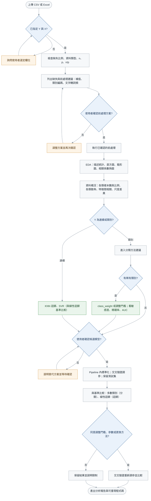
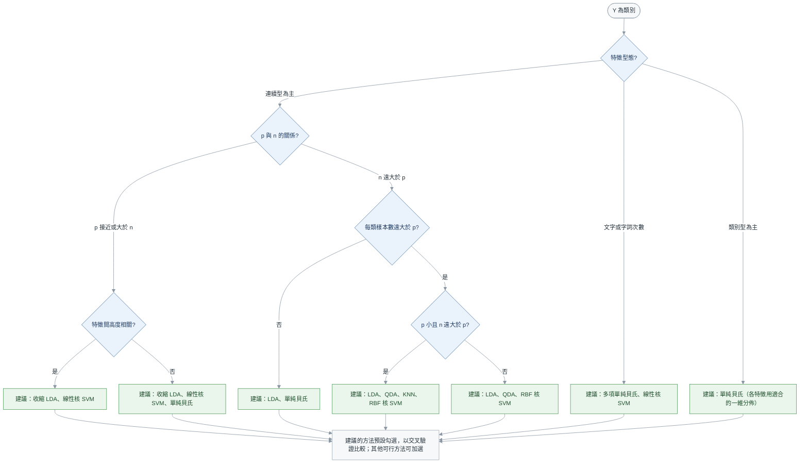

# KNN、區別分析、單純貝氏與支援向量機決策樹

主流程依序為：上傳 CSV/Excel → 指定 Y/X → 資料檢查 → 確認前處理 → EDA 與資料概況 → 判斷 Y 類型 → 方法建議與可行性檢查 → 確認候選模型 → 標準化與交叉驗證調參 → 與基準比較 → 確認是否調整門檻或修正 → 輸出分析報告與可重現程式碼。

## 主流程

藍色菱形為判斷、綠色為方法、橘色為需要與使用者確認的步驟；Y 為類別時接到下方的分類方法建議。

## 分類方法建議

方法選擇分兩層：

| 層次 | 位置 | 作用 |
|:--|:--|:--|
| **建議** | 下方流程圖、數值門檻表的「建議依據」 | 依資料特性指出「建議優先比較」的方法 |
| **可行性** | 只在程式與數值門檻表的「可行性條件」，不畫進流程圖 | 只剔除數學上無法估計或計算上跑不完的方法 |

使用者選單：**建議方法預設勾選**；**其他可行方法列出但不勾選**，可加選；**不可行方法**列出原因，不能選。比較基準（多數類別、logistic 迴歸）一律自動加入，不出現在選單中。

圖中為建議優先比較的方法；數學上無法估計或計算量過大的方法（例如某類每折樣本數不超過 p 時的 QDA、訓練資料超過 20,000 筆時的核 SVM）由程式另外剔除並說明原因。特徵間高度相關時，各分支都不建議單純貝氏。

迴歸（Y 連續）：p ≤ 10 且 n/p ≥ 20 時建議 KNN 迴歸、SVR；其他情況建議 SVR，KNN 迴歸列為其他可行方法（特徵多或 n/p 小時 KNN 受維度影響大）。SVR 不可行時改建議 KNN 迴歸。比較用的線性迴歸一律自動加入。

## 數值門檻（`run_analysis.py profile` 採用的預設）

這些門檻讓判斷可重現；報告中須列出實際數值與門檻，資料接近門檻時說明理由。表中 **p = 編碼後進入模型的欄位數**：數值欄位數加上各類別變數的水準數 − 1（LDA、QDA、單純貝氏刪除基準水準）；KNN 與 SVM 使用完整編碼，水準數不減 1。n 一律指訓練資料筆數；**每折最小類別筆數** = 最小類別筆數 × (折數 − 1)/折數；**r_max** = 數值特徵間最大相關係數絕對值。

**建議依據**（決定預設勾選哪些方法）

| 判斷 | 門檻 | 來源 |
|:--|:--|:--|
| 類別型為主（建議 `nb_mixed`） | 類別型特徵 ≥ 全部特徵的一半 | ISLP，門檻自訂 |
| p 接近 n（建議收縮 LDA、線性核 SVM） | n/p < 10 | ESL 第 18 章、ISLP 第 9 章，門檻自訂 |
| 高度相關時不建議單純貝氏 | r_max ≥ 0.7 | ISLP 第 4 章，門檻自訂 |
| 每類樣本數遠大於 p（建議 QDA、RBF 核 SVM） | 每折最小類別筆數 ≥ 10p | ISLP，門檻自訂 |
| KNN 適用（建議 KNN、KNN 迴歸） | p ≤ 10 且 n/p ≥ 20 | ISLP，門檻自訂 |
| 稀有類別（調整門檻或 class_weight） | 最小類別比例 < 10% | 自訂 |
| 不平衡（改變選模指標） | 最小類別比例 < 20%：二元用 AUC、多類別用平衡準確率；否則用準確率 | 自訂 |

建議的判斷順序：文字欄位 → 類別型為主 → n/p < 10（依 r_max 分兩支）→ 每折最小類別筆數 < 10p → p ≤ 10 且 n/p ≥ 20 → 其他。

**可行性條件**（只剔除無法估計或跑不完的方法）

| 方法 | 不可行的條件 | 來源 |
|:--|:--|:--|
| QDA | 每折最小類別筆數 ≤ p（該類共變異矩陣無法估計） | 數學條件 |
| LDA | p ≥ n（合併共變異矩陣奇異，改用收縮 LDA） | 數學條件 |
| 核 SVM／SVR | 訓練資料 n > 20,000（`max_n_kernel`）；線性 SVM 此時改用 `LinearSVC` | scikit-learn 文件與實測，門檻自訂 |
| 多項單純貝氏 | 沒有文字欄位 | 只用於文字或計數資料 |
| 單純貝氏（連續＋類別） | 沒有類別型特徵 | 此時與高斯單純貝氏相同 |
| 文字以外的方法 | 有文字欄位 | 文字分類只使用文字欄位 |

建議方法中若有不可行者，從建議移到不可行；若因此建議清單變空，分類改建議線性核 SVM、迴歸改建議 KNN 迴歸，並在理由中說明。其他可行方法 = 全部方法 − 建議 − 不可行。

## 操作原則

- **先看資料再選方法**：n、p（原始變數數與編碼後欄位數）、n/p、特徵型態、各類樣本數與比例、每折最小類別筆數、各類散佈、特徵間相關、尺度差異，都在 EDA 階段算出並列給使用者。
- **圖中為建議；門檻只用來排除無法估計或跑不完的方法，其他診斷數值是參考，不是自動決策規則。**建議方法預設勾選，使用者可加選其他可行方法；勾選的方法全部進入交叉驗證比較。
- **不必先做常態或共變異同質性檢定**：LDA、QDA 是否合適，以交叉驗證比較為準；EDA 的分組散佈圖只用來輔助解讀。
- **每折最小類別筆數 ≤ p 時 QDA 不可行**：該類的共變異矩陣無法估計。
- **收縮 LDA 在 p 接近 n（n/p < 10）時建議**：此時合併共變異矩陣也不穩定；n/p ≥ 10 時一般 LDA 即可。
- **特徵間高度相關時不建議單純貝氏**：獨立假設不成立，偏差不會因資料增加而消失；使用者仍可加選，但須在報告中說明。
- **KNN 與 SVM 一定要標準化**，且標準化放在 `Pipeline` 中，只用訓練資料估計平均與標準差，避免資料洩漏。
- **調參一律用交叉驗證**：KNN 的 k 取 1 到約 √n 的奇數；RBF 核 SVM 的 C、γ 先以粗網格搜尋（C = 2⁻⁵…2¹⁵、γ = 2⁻¹⁵…2³，以 2⁴ 為間隔並包含端點），再在最佳點附近以 2^±1、2^±2 加密，兩者要一起調；SVR 另外調 ε。資料有排序或時間結構時，交叉驗證要打亂或依時間切分。
- **一定要與基準比較**：分類與「永遠預測多數類別」比較，迴歸與線性迴歸比較；所有方法都不比基準好時，告知使用者資料的訊號很弱。
- **稀有類別不看整體錯誤率**：改看敏感度、精確率、AUC，並與使用者確認門檻或 class_weight。
- **需要機率時優先 LDA**。
- 未經授權不得擅自刪資料、修改變數、調參或更換模型。輸出前確認資料處理紀錄、EDA、方法、評估指標、套件版本與重現程式碼齊全。
